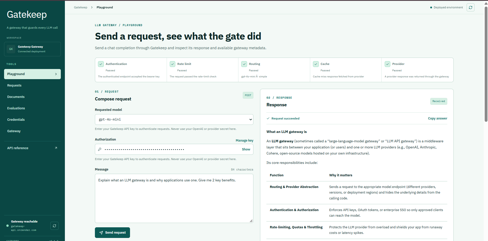

# Gatekeep

**An LLM gateway that guards every AI request.**

Gatekeep is a centralized gateway for managing LLM requests, with intelligent routing, caching, rate limiting and request monitoring. Built with FastAPI and React, it provides a unified interface to interact with AI providers and inspect request behaviour.

**Live Demo: https://usegatekeep.vercel.app/

 GitHub Repository: https://github.com/Viinuthaa/gatekeep**

## Preview



## Features

- **Request Routing:** Routes LLM requests based on complexity and routing logic.
- **API Authentication:** Secures requests using Bearer token authentication.
- **Response Caching:** Uses Redis to cache responses and reduce redundant provider calls.
- **Rate Limiting:** Controls request frequency and API consumption.
- **Request Monitoring:** Tracks request history, latency, token usage and response status.
- **Document Search:** Supports document ingestion and semantic retrieval.
- **Evaluations:** Evaluates model responses using expected-content checks.
- **Interactive Playground:** Test prompts and inspect responses, routing decisions and metadata.

## Tech Stack

| Layer | Technologies |
|---|---|
| Frontend | React, TypeScript, Vite |
| Backend | Python, FastAPI |
| Database | PostgreSQL, Neon, SQLAlchemy |
| Caching | Redis |
| AI Integration | OpenRouter |
| Migrations | Alembic |
| Deployment | Vercel, Render |

## Architecture

```text
             React + TypeScript
                     |
                     v
                FastAPI Gateway
                     |
          +----------+----------+
          |          |          |
       Auth       Routing    Rate Limiting
          |          |          |
          +----------+----------+
                     |
                LLM Provider
                     |
             +-------+-------+
             |               |
           Redis         PostgreSQL
       Cache / Limits    Request Logs
```

## Running Locally

**1. Clone the repository**

```bash
git clone https://github.com/Viinuthaa/gatekeep.git
cd gatekeep
```

**2. Install backend dependencies**

```bash
python -m venv .venv
.venv\Scripts\activate
pip install -r requirements.txt
```

**3. Configure environment variables**

Create a `.env` file in the project root with your PostgreSQL, Redis, OpenRouter and Gatekeep API key configuration.

**4. Run migrations and start the backend**

```bash
alembic upgrade head
uvicorn app.main:app --reload
```

**5. Start the frontend**

```bash
cd frontend
npm install
npm run dev
```

Create `frontend/.env` with:

```env
VITE_API_BASE_URL=http://127.0.0.1:8000
VITE_GATEKEEP_API_KEY=your_gateway_key
```

## Testing

Backend test suite: **81 tests passed** in the recorded test run.

```bash
pytest
```

---

